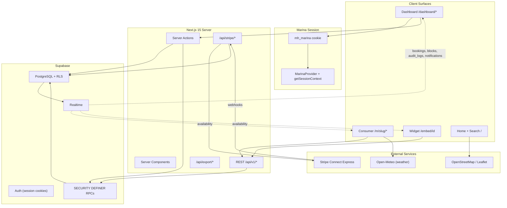

# MarinaHub

Multi-marina boat rental platform — staff dashboard, consumer storefront, and embeddable booking widget in a single Next.js 15 app.

---

## Project Overview

Marina operators juggle phone bookings, spreadsheets, and disconnected websites — especially when they run more than one location. **MarinaHub** unifies marina operations, guest booking, and white-label embeds in one platform with marina-scoped multi-tenancy, realtime sync, dynamic pricing, and Stripe Connect payments (test mode).

### PRD Alignment


| Tier             | Delivered                                                                                             |
| ---------------- | ----------------------------------------------------------------------------------------------------- |
| **Tier 1 (MVP)** | Dashboard, fleet, bookings, calendar, customers, RBAC, consumer booking, widget                       |
| **Tier 2**       | Multi-marina switcher, dynamic pricing, audit/activity feed, waitlist, segmentation, revenue forecast |
| **Tier 3**       | Stripe Connect payments, reviews & ratings, map view, weather forecast, CSV export, mobile polish     |
| **Out of scope** | React Native app, MFA, SMS, full Connect payouts, PDF waivers, IoT/GPS                                |


---

## Architecture




### Key Flows

**Session model:** Dashboard reads `mh_marina` httpOnly cookie → `getSessionContext()` → all dashboard actions call `assertActiveMarina()`. RLS enforces `marina_id IN auth_user_marina_ids()` on every operational table. Consumer/widget routes are scoped by marina slug or embed ID — not the staff cookie.

**Pricing flow:** Consumer/widget calls `resolve_booking_price` RPC (server-side) → quote API → booking wizard display → `createPublicBooking` recomputes server-side → stores `pricing_rule_id`, `pricing_breakdown`, `tax_amount`. Precedence: **Holiday > Peak Season > Weekend > Weekday** (mirrored in `classify_pricing_day()` and `src/lib/pricing/classify-day.ts`).

**Payment flow:** Booking created as `pending` / `unpaid` → Stripe Checkout session (line items match base + add-ons + tax) → `checkout.session.completed` webhook → `confirm_booking_payment` RPC (idempotent on `stripe_event_id`) → booking `confirmed` / `paid`. Confirmation page syncs if webhook is delayed.

**Audit → Activity:** DB triggers + server actions → `write_audit_log_internal` → `audit_logs` table → Supabase Realtime → Activity Feed UI.

---

## Tech Stack


| Layer         | Choice                   | Justification                                                       |
| ------------- | ------------------------ | ------------------------------------------------------------------- |
| Framework     | Next.js 15 App Router    | RSC + Server Actions; single deploy for dashboard, consumer, widget |
| Language      | TypeScript               | End-to-end type safety with Supabase generated types                |
| Database      | Supabase PostgreSQL      | Row-level security for multi-tenancy; migrations; Realtime          |
| Auth          | Supabase Auth            | Unified consumer + staff sessions; SSR cookie handling              |
| UI            | Tailwind CSS + shadcn/ui | Accessible components; fast polish sprint                           |
| Charts        | Recharts                 | Dashboard analytics and revenue forecast                            |
| Data fetching | TanStack Query           | Client-side availability cache + realtime invalidation              |
| Payments      | Stripe Connect Express   | Destination charges with platform fee; test-mode demo               |
| Maps          | Leaflet + OpenStreetMap  | No API key required for demo                                        |
| Weather       | Open-Meteo               | Free forecast API; server-cached ~30 min                            |
| Tests         | Vitest + Playwright      | Unit tests for business logic; E2E for critical flows               |


---

## Mobile Application

A React Native companion mobile app built with Expo (SDK 56) is available in the [mobile/](file:///Users/adityachauhan/Desktop/AdityaChauhan/BraveBrowser/Website/MarinaHub/mobile) directory. 

For information on setup, generating native project folders (`android` and `ios`), and manually building the app, please refer to the [Mobile README](file:///Users/adityachauhan/Desktop/AdityaChauhan/BraveBrowser/Website/MarinaHub/mobile/README.md).

---

## Feature List

### Marina Operations

- [x] Dashboard overview with KPIs, revenue charts, utilization, average rating
- [x] Realtime activity feed (dashboard home + `/dashboard/activity`)
- [x] Fleet management (boats CRUD, images)
- [x] Bookings list + detail with status timeline
- [x] Multi-boat calendar with bookings and availability blocks
- [x] Check-in / check-out workflow (`confirmed → checked_in → checked_out → completed`)
- [x] Customer CRM profiles + manual VIP override
- [x] Customer segmentation (First-Time / Returning / VIP)
- [x] Maintenance logs
- [x] Team management (owner)
- [x] Email template previews
- [x] Onboarding wizard (4 steps)
- [x] Notifications (real-time bell + feed, marina-scoped)
- [x] Waitlist management + in-app notification on slot open
- [x] Conflict resolution — ranked alternative boats when slot unavailable
- [x] Audit logs (`/dashboard/audit-logs`, owner)
- [x] RBAC: owner / manager / staff

### Intelligence & Pricing

- [x] Dynamic pricing — weekday / weekend / holiday / peak season rules
- [x] Holiday calendar
- [x] Live quote in consumer checkout and widget
- [x] Revenue forecasting — 30-day confirmed + projected chart
- [x] Analytics — revenue, utilization, popular boats

### Marina Settings

- [x] Business hours, booking buffer, cancellation policy (display)
- [x] Tax rate, deposit %, currency (INR default)
- [x] Contact & location (phone, email, lat/lng for map/weather)
- [x] VIP segmentation thresholds

### Payments

- [x] Stripe Connect Express onboarding (owner, test mode)
- [x] Stripe Checkout for consumer + widget bookings
- [x] Webhook confirmation + idempotent payment ledger
- [x] Payments dashboard — gross revenue, platform fee, net payout, transactions
- [x] Abandoned checkout cleanup (30 min session expiry)
- [x] Demo fallback — instant confirm when Stripe env vars unset

### Consumer

- [x] Unified auth (`/auth/login`, signup, forgot/reset password)
- [x] My Trips, Favorites, Profile, Settings
- [x] Marina storefront `/m/[slug]` + booking wizard
- [x] Booking add-ons + digital waiver checkbox
- [x] Digital ticket with QR code + trip weather
- [x] Guest checkout + account linking by email
- [x] Reviews — one per completed booking; aggregate rating on boat/marina
- [x] Home map + search with map/list toggle
- [x] Weather forecast on boat detail, confirmation, itinerary, ticket

### Widget

- [x] Embeddable iframe + `public/widget/embed.js`
- [x] API key authentication
- [x] Per-marina branding (color, font, logo, button text, border radius)
- [x] Live preview in dashboard
- [x] Same availability, pricing, and booking flow as consumer

### Platform & Polish

- [x] Supabase RLS on all tables (marina-scoped multi-tenancy)
- [x] Realtime on bookings, blocks, audit_logs, notifications
- [x] Rate limiting on auth, booking, waitlist, widget, ticket endpoints
- [x] CSV export — bookings, customers, revenue (owner/manager; marina-scoped)
- [x] Empty/loading states + route skeletons
- [x] Mobile responsive — sidebar drawer, table→card, sticky Book Now
- [x] Demo seed: 4 marinas, fleet, bookings, reviews, coordinates
- [x] Security hardening migrations `042`, Stripe hardening `046`–`049`

---

## Role Matrix


| Capability                            | Owner | Manager | Staff | Consumer  |
| ------------------------------------- | ----- | ------- | ----- | --------- |
| Dashboard home / activity feed        | ✓     | ✓       | ✓     | —         |
| Bookings read / create                | ✓     | ✓       | ✓     | own trips |
| Confirm / cancel booking              | ✓     | ✓       | —     | —         |
| Check-in / check-out / complete       | ✓     | ✓       | ✓     | —         |
| Fleet / availability / maintenance    | ✓     | ✓       | —     | —         |
| Customers read                        | ✓     | ✓       | ✓     | —         |
| Customers write / segments            | ✓     | ✓       | —     | —         |
| Analytics / revenue forecast          | ✓     | ✓       | —     | —         |
| Waitlist                              | ✓     | ✓       | —     | —         |
| Settings / pricing / holidays         | ✓     | —       | —     | —         |
| Team / widget / payments / audit logs | ✓     | —       | —     | —         |
| CSV export (bookings, customers)      | ✓     | ✓       | —     | —         |
| CSV export (revenue)                  | ✓     | —       | —     | —         |
| Book & pay online                     | —     | —       | —     | ✓         |
| Leave review (completed trips only)   | —     | —       | —     | ✓         |
| Favorites / account settings          | —     | —       | —     | ✓         |


Source of truth: `middleware.ts` (route guards), `src/lib/auth/rbac.ts` (permissions), `src/lib/dashboard/nav.ts` (sidebar visibility).

---

## Multi-Marina Data Model

MarinaHub uses **marina-scoped multi-tenancy** — there is no organization layer above `marinas`.

```
┌─────────────┐     ┌──────────────────┐     ┌─────────────┐
│  profiles   │────▶│ marina_members   │◀────│   marinas   │
│ (auth user) │     │ user_id + role   │     │  (tenant)   │
└─────────────┘     │ owner/mgr/staff  │     └──────┬──────┘
                    └──────────────────┘            │
                                                    │ marina_id (FK)
                    ┌───────────────────────────────┼───────────────────────────────┐
                    ▼               ▼               ▼               ▼               ▼
               boats          bookings        customers    marina_settings    audit_logs
               pricing_rules  waitlist        segments     widget_configs   payment_transactions
```

**Active marina session:** Header switcher → `switchActiveMarina()` → updates `mh_marina` cookie → `revalidatePath("/dashboard")` + TanStack Query invalidation → all dashboard data re-fetches for the new marina.

---

## Getting Started

### Prerequisites

- Node.js 20+
- npm
- [Supabase](https://supabase.com) project
- [Stripe](https://dashboard.stripe.com) account in **Test mode** (optional — demo works without Stripe)

### 1. Clone & Install

```bash
git clone <repo-url>
cd MarinaHub
npm install
```

### 2. Supabase Setup

1. Create a project at [supabase.com](https://supabase.com)
2. Run migrations in order from `supabase/migrations/` (**through `049_stripe_audit_hardening.sql`**)
3. Create Storage bucket `boats` (public read)
4. Enable Realtime for: `bookings`, `availability_blocks`, `boats`, `notifications`, `maintenance_logs`, `**audit_logs**`
5. **Demo:** Authentication → Email → disable **Confirm email**
6. Redirect URLs: `{SITE_URL}/auth/callback`, `{SITE_URL}/auth/reset-password`

### 3. Environment Variables

```bash
cp .env.example .env.local
```


| Variable                             | Purpose                                            |
| ------------------------------------ | -------------------------------------------------- |
| `NEXT_PUBLIC_SUPABASE_URL`           | Supabase project URL                               |
| `NEXT_PUBLIC_SUPABASE_ANON_KEY`      | Anon key (client-safe)                             |
| `SUPABASE_SERVICE_ROLE_KEY`          | Server/admin operations                            |
| `NEXT_PUBLIC_APP_URL`                | App base URL (`http://localhost:3000`)             |
| `NEXT_PUBLIC_SITE_URL`               | Auth redirect URLs                                 |
| `STRIPE_SECRET_KEY`                  | Stripe secret key (`sk_test_…`) — server only      |
| `NEXT_PUBLIC_STRIPE_PUBLISHABLE_KEY` | Stripe publishable key (`pk_test_…`)               |
| `STRIPE_WEBHOOK_SECRET`              | Webhook signing secret (`whsec_…`) from Stripe CLI |


### 4. Seed & Run

```bash
npm run seed:demo   # 4 marinas, fleet, bookings, reviews, coordinates
npm run dev
```

Open [http://localhost:3000](http://localhost:3000).

### 5. Stripe Local Webhook (for payment testing)

```bash
stripe listen --forward-to localhost:3000/api/stripe/webhook
```

Copy the `whsec_…` signing secret printed by the CLI into `STRIPE_WEBHOOK_SECRET` in `.env.local`.

### 6. Tests

```bash
npm run test        # Vitest — 141+ unit tests
npm run test:e2e    # Playwright E2E (smoke)
E2E_RUN_INTEGRATION=1 npm run test:e2e   # Live Supabase integration tests
```

---

## Demo Credentials

Password for all demo accounts: `**DemoMarina2026!**`


| Email                          | Role     | Notes                           |
| ------------------------------ | -------- | ------------------------------- |
| `owner@stateparkmarina.demo`   | Owner    | All 4 marinas                   |
| `manager@stateparkmarina.demo` | Manager  | State Park only                 |
| `staff@stateparkmarina.demo`   | Staff    | Check-in/out; no fleet/settings |
| `alex.rivera@demo.com`         | Consumer | Completed trips → leave review  |
| `jamie.chen@demo.com`          | Consumer |                                 |


**Widget API key (State Park):** `mh_demo_statepark_2026_key`

---

## Routes


| Route                                 | Description                                |
| ------------------------------------- | ------------------------------------------ |
| `/`                                   | Landing + Explore Marinas map              |
| `/search`                             | Marina/boat search with map/list toggle    |
| `/auth/login`                         | Unified login (marina or consumer intent)  |
| `/dashboard`                          | Dashboard + activity feed + forecast       |
| `/dashboard/settings`                 | Marina settings + pricing rules + holidays |
| `/dashboard/payments`                 | Stripe Connect + revenue dashboard         |
| `/dashboard/audit-logs`               | Audit log viewer (owner)                   |
| `/dashboard/activity`                 | Full activity feed                         |
| `/dashboard/waitlist`                 | Waitlist management                        |
| `/dashboard/customers/segments`       | Segmentation dashboard                     |
| `/dashboard/analytics`                | Revenue + 30-day forecast                  |
| `/dashboard/widget`                   | Widget branding + live preview             |
| `/m/[slug]`                           | Consumer marina profile                    |
| `/m/[slug]/boats/[id]`                | Boat detail (reviews, weather, booking)    |
| `/m/[slug]/booking/confirmation/[id]` | Booking confirmation                       |
| `/m/[slug]/booking/ticket/[token]`    | Digital ticket + QR                        |
| `/m/[slug]/booking/itinerary/[token]` | Trip itinerary + weather                   |
| `/embed/[marinaId]`                   | Embeddable widget                          |
| `/account/trips`                      | Consumer My Trips                          |


Legacy routes (`/marina/login`, `/account/login`) redirect to `/auth/`*.

---

## Stripe Connect Express (Test Mode)

### Prerequisites

1. Create a [Stripe](https://dashboard.stripe.com) account → switch to **Test mode**
2. **Enable Connect** on your platform: Dashboard → Connect → Get started
3. Copy keys to `.env.local` (see env table above)
4. Start webhook forwarding:
  ```bash
   stripe listen --forward-to localhost:3000/api/stripe/webhook
  ```

### Test Cards (INR Checkout)


| Card                  | Result    |
| --------------------- | --------- |
| `4242 4242 4242 4242` | Success   |
| `4000 0025 0000 3155` | 3D Secure |
| `4000 0000 0000 0002` | Declined  |


Use any future expiry, any CVC, and a valid billing address (required for INR / India export compliance).

Connect onboarding in test mode: use test phone `000 000 0000` and skip verification prompts.

### End-to-End Payment Flow

1. **Owner** → Dashboard → Payments → **Connect Stripe** (Express onboarding, country IN)
2. Complete onboarding → return URL syncs `stripe_onboarding_complete` → **Connected Account ✓** badge
3. **Consumer** → Book Now → booking created as `pending` / `unpaid` → redirect to Stripe Checkout
4. Pay with test card → `checkout.session.completed` webhook (or confirmation-page sync) → booking `confirmed` / `paid`
5. **Owner** → Payments dashboard → revenue, platform fee, and transaction ledger update

### Abandoned Checkout

- Checkout sessions expire after **30 minutes**
- Webhook `checkout.session.expired` cancels the booking and releases the slot
- User cancel from Stripe returns to the boat page; slot held until expiry

### Webhook Events


| Event                        | Purpose                                   |
| ---------------------------- | ----------------------------------------- |
| `checkout.session.completed` | Confirm booking + ledger row (idempotent) |
| `checkout.session.expired`   | Cancel unpaid booking + release slot      |
| `account.updated`            | Sync Connect onboarding flags             |
| `charge.refunded`            | Mark booking refunded + ledger row        |
| `payout.paid`                | Record payout in transaction history      |


### Security Notes

- `STRIPE_SECRET_KEY` is server-only; never sent to the client
- Webhook route verifies `stripe-signature` with raw body using `STRIPE_WEBHOOK_SECRET`
- `confirm_booking_payment` RPC deduplicates on `stripe_event_id`
- Connect onboarding requires authenticated **owner** role
- Without Stripe env vars, consumer bookings fall back to instant confirmation (demo mode)

Apply migrations `**046`–`049`** on all environments.

---

## Database (Key Tables)


| Table                        | Purpose                                               |
| ---------------------------- | ----------------------------------------------------- |
| `marinas`                    | Tenant root entity (slug, branding, geo)              |
| `marina_members`             | User ↔ marina RBAC junction                           |
| `marina_settings`            | Business hours, tax, deposit, buffer, policies        |
| `pricing_rules`              | Dynamic pricing by day type / peak / holiday          |
| `marina_holidays`            | Shared holiday calendar                               |
| `boats`                      | Fleet inventory                                       |
| `bookings`                   | Reservations + pricing_breakdown, tax, payment fields |
| `booking_addons`             | Add-on line items                                     |
| `customers`                  | CRM profiles (linked to auth users when registered)   |
| `reviews`                    | Guest reviews (one per completed booking)             |
| `payment_transactions`       | Stripe webhook-derived payment ledger                 |
| `marina_payment_accounts`    | Stripe Connect Express account state                  |
| `audit_logs`                 | Append-only audit + activity feed source              |
| `waitlist_entries`           | Waitlist with notification flow                       |
| `customer_segment_snapshots` | Computed First-Time / Returning / VIP                 |
| `widget_configs`             | Per-marina embed branding                             |


Migrations: `001`–`049` in `supabase/migrations/`.

---

## Known Limitations & Assumptions

- **Cancellation policy** is displayed in settings but not enforced on automated refunds
- **Business hours** constrain slot UI only — not server-side enforcement on booking create
- **Waitlist** notifications are in-app only for linked accounts (no guest email yet)
- **Digital waiver** is a checkbox timestamp — no PDF/signature capture
- **Timezone:** `marinas.timezone` vs `marina_settings.timezone` may diverge in edge cases
- **Confirmation page** accepts booking UUID; token-only access is listed as future hardening
- **Weather/map** require seeded `lat`/`lng` on marina records
- **INR** is the default currency; Connect onboarding uses country IN in test mode
- **Rating cache** on boat detail may require refresh after submitting a review

---

## Future Improvements

### Production launch (P0)

- Digital waivers — PDF/signature capture
- Transactional email — Resend/SendGrid for confirmations, review prompts

### Near-term hardening

- Wire `cancellation_policy` to cancel/refund logic
- Waitlist guest email notifications
- Server-side business-hours enforcement on booking create
- Multi-day pricing pro-ration across weekday/weekend boundaries
- Rate limiting on `/api/v1/marinas/quote` and `/alternatives`
- Booking confirmation: require ticket token instead of UUID
- E2E: full waitlist → cancel → notification flow

### Phase 3 (out of scope for this release)

- **React Native** mobile app (now available under [mobile/](file:///Users/adityachauhan/Desktop/AdityaChauhan/BraveBrowser/Website/MarinaHub/mobile))
- **MFA / 2FA** and **SMS/Twilio** notifications
- **Full Stripe Connect payouts** and **Lake Cash wallet**
- **Reviews moderation** dashboard
- **Weather alerts** and push notifications
- **Offline mode** for marina staff
- **PDF export** for bookings and revenue reports
- **Insurance / license upload** for renters
- **IoT / GPS** fleet tracking
- **Organization layer** above marinas + portfolio rollup reporting
- **SOC2-style audit export** with retention policy
- **pg_cron** for waitlist expiry + segment batch refresh

---

## Recommended Stopping Point

**Ship MVP + Phase 2 + Polish + Stripe (test mode) as the feature-complete demo release.**

Before production:

1. Record demo video → paste Loom URL above
2. Run `E2E_RUN_INTEGRATION=1 npm run test:e2e` against seeded Supabase
3. Apply migrations `046`–`049` on all environments
4. Complete digital waivers + transactional email (P0)

---

## License

See repository license file. Demo data and credentials are for local/testing use only.
